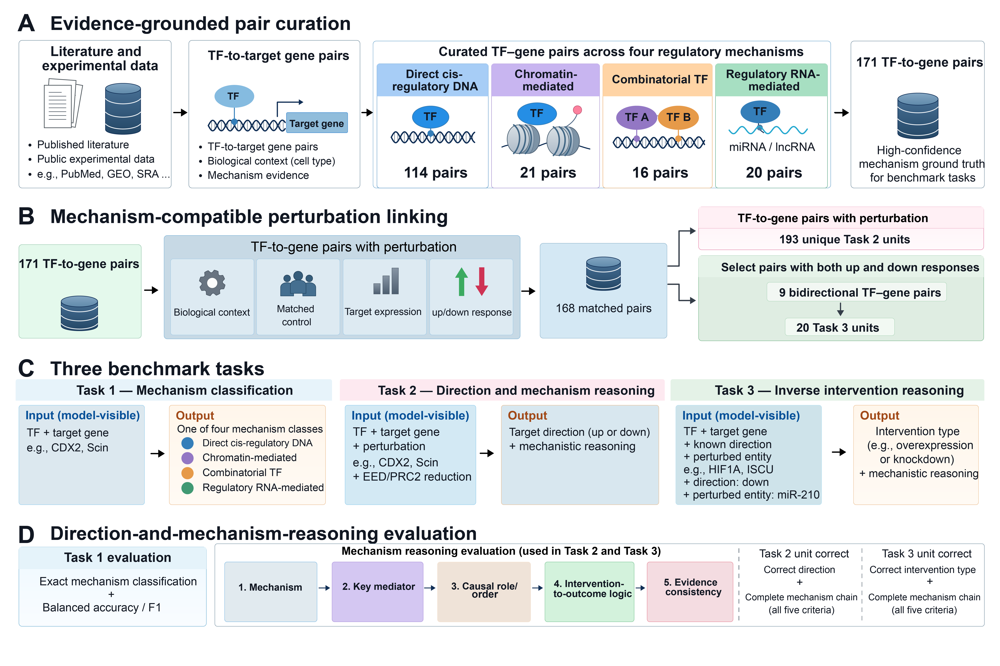

# MeBench: Benchmarking Biological Mechanism Reasoning in Language Models through TF–Gene Regulation

<p align="center">
  
</p>

<p align="center"><em>MeBench construction and evaluation: 171 curated TF–gene pairs, 193 forward-reasoning units, and 20 inverse-intervention units, assessed with a shared five-axis mechanistic rubric.</em></p>

MeBench is a benchmark for evaluating the ability of language models to reason about biological mechanisms underlying transcription factor (TF)–gene regulation. Beyond identifying molecular entities and their associations, MeBench assesses whether models can recover the regulatory relationships and mechanistic dependencies supported by experimental evidence.

This repository provides the complete evaluation artifacts, including benchmark inputs, prompts, evaluator gold standards, scoring implementation, model responses, adjudication records, and reproducibility scripts.

## Overview

MeBench evaluates biological mechanism reasoning through three benchmark tasks. The evaluation considers not only whether a model identifies relevant biological components, but also whether it correctly interprets their regulatory relationships and mechanistic dependencies.

The released artifacts support:

- Reproduction of benchmark scores using the frozen evaluation bundle.
- Inspection of model predictions and verbatim responses.
- Examination of five-axis adjudication results.
- Analysis of performance across systems, tasks, and repeated runs.
- Verification of reported results through checksums and audit records.

## Benchmark and Evaluation

### Evaluated Systems

We evaluate six systems under two settings:

| Setting                     | Systems                                                                   |
| --------------------------- | ------------------------------------------------------------------------- |
| Closed-book language models | GPT-6-Astra, Claude-Sonnet-5.5, Gemini-3.8-Flash, GLM-5.3-Flash, Grok-4.6 |
| Tool-augmented agent        | Biomni                                                                    |

The five closed-book systems are evaluated using byte-identical prompts at temperature 0. Biomni is evaluated as a tool-augmented agent.

Each system has four recorded runs for each task. Original model responses and run-level evaluation records are retained in the repository.

### Evaluation Protocol

The benchmark uses a structured evaluation protocol to assess model responses against evaluator-defined reference mechanisms.

The evaluation artifacts include:

- Benchmark inputs and evaluator-only gold standards.
- A released scoring implementation.
- Five-axis adjudication records.
- Run-level scores and consolidated evaluation tables.
- A separately disclosed scoring amendment for the regulatory-RNA knockdown/inhibition alias.

Two family-level failure measures are reported separately:

1. **Causal-order-axis failure:** failure to recover the correct causal ordering.
2. **Full five-axis chain failure:** failure under the complete five-axis evaluation criterion.

These measures capture distinct aspects of mechanistic reasoning and should not be treated as interchangeable.

## Quick Start

Clone the repository:

```
git clone https://github.com/Max-YUAN-22/MeBench.git
cd MeBench
```

### 1. Verify Artifact Integrity

Verify the SHA-256 checksums of the released artifacts:

```
shasum -a 256 -c MANIFEST.sha256
```

### 2. Score a Model Run

The released scorer can be used to evaluate an individual prediction file:

```
python3 evaluation_v3.7.0/scoring/score_model_outputs.py \
    --bundle evaluation_v3.7.0 \
    --task task1 \
    --predictions runs/claude/run1/task1_predictions.tsv \
    --output /tmp/x.json
```

The example above reproduces the scoring procedure for Claude's first run on Task 1. Other systems, runs, and tasks can be evaluated by specifying the corresponding prediction files and task identifiers.

A complete worked example — prompt, input unit, model response, adjudication record, and gold annotation for one unit (Task 2, T2U_0010) — is provided under `examples/T2U_0010_worked_example/`.

### 3. Reproduce Aggregate Results

To recompute the published aggregate statistics:

```
python3 scripts/compute_final_stats.py
```

To perform the full per-run recomputation and audit:

```
python3 scripts/audit_recompute_all.py
```

For the complete verification procedure, see `analysis/audit_report.html`.

## Repository Structure

```
MeBench/
├── evaluation_v3.7.0/       # Frozen benchmark bundle and released scorer
├── prompts/                 # Exact prompts used in model evaluations
├── runs/                    # Raw responses, predictions, adjudications,
│                            # and per-run scores
├── results/                 # Consolidated results and derived statistics
├── analysis/                # Audit records, claim verification,
│                            # and data provenance
├── scoring_amendment/       # Disclosed scoring amendment layer
├── scripts/                 # Reproduction and audit scripts
├── examples/                # Worked example: one unit through the full pipeline
├── paper/
│   └── supplement/          # Supplementary materials and detailed analyses
├── MANIFEST.sha256          # Artifact integrity manifest
└── README.md
```

### Key Artifacts

| Directory / File     | Description                                                                                                                               |
| -------------------- | ----------------------------------------------------------------------------------------------------------------------------------------- |
| `evaluation_v3.7.0/` | Frozen benchmark inputs, evaluator-only gold standards, released scorer, and prediction templates.                                        |
| `prompts/`           | Exact prompts supplied to the evaluated closed-book systems, together with prompt checksums and audit records.                            |
| `runs/`              | Per-system and per-run predictions, raw responses, adjudication packets, judgments, and scores.                                           |
| `results/`           | Main results, five-axis decomposition, joint metrics, per-run statistics, and derivation tables.                                          |
| `analysis/`          | Audit reports, claim-verification records, causal-order failure enumerations, and data provenance records.                                |
| `scoring_amendment/` | The disclosed regulatory-RNA knockdown/inhibition alias amendment, implemented as a separate layer without modifying the released scorer. |
| `paper/supplement/`  | Supplementary tables, worked examples, protocol details, reproducibility materials, and detailed failure analyses.                        |

The `runs/` directory also contains consolidated master tables (`MASTER_task1.tsv`, `MASTER_task2.tsv`, and `MASTER_task3.tsv`) and the corresponding data dictionary, providing a unified record of benchmark units, systems, runs, responses, and evaluation judgments.

## Reproducibility and Data Integrity

All released artifacts were frozen on October 16–17, 2026. Their SHA-256 checksums are recorded in `MANIFEST.sha256`.

The release preserves:

- Original model responses and prediction files.
- Exact evaluation prompts.
- Frozen benchmark inputs and evaluator gold standards.
- Run-level adjudication records and scores.
- Derived statistical results and their underlying data.
- Audit records documenting discrepancies and corrections.

No post-freeze changes to experimental runs, re-administrations, adjudications, or reported values are incorporated into the frozen release.

The full audit trail and verification records are available under `analysis/`.

## Scoring and Evaluation Notes

All model outputs are evaluated against the canonical matcher according to the disclosed scoring protocol. Outputs that are interpretable but do not satisfy the required output format are scored as incorrect; affected cases are documented in the supplementary materials.

For uninterpretable outputs, the specified re-administration policy permits one additional administration under the identical prompt. Original captures are retained in the corresponding run directories.

The scoring amendment for the regulatory-RNA knockdown/inhibition alias is maintained separately from the released scorer to preserve the original evaluation implementation.

**Adjudication status:** Run-level adjudication records are included for all six systems across all three tasks and four runs. Chain/joint metrics remain preliminary pending blinded human adjudication. The corresponding adjudication packets are provided for independent review. These metrics should be interpreted accordingly.

## License

Code is released under the MIT License (`LICENSE`). Benchmark data and annotations are released under CC BY 4.0.

## Citation

If you use MeBench in your research, please cite the associated paper. The bibliographic information will be provided with the public manuscript release; machine-readable citation metadata is available in `CITATION.cff`.

## Contact

For questions about the benchmark, evaluation protocol, or reproducibility artifacts, please open an issue in this repository, or contact the corresponding author:

**Prof. Haohan Wang** (corresponding author) — School of Information Sciences, University of Illinois Urbana-Champaign — [haohanw@illinois.edu](mailto:haohanw@illinois.edu)
